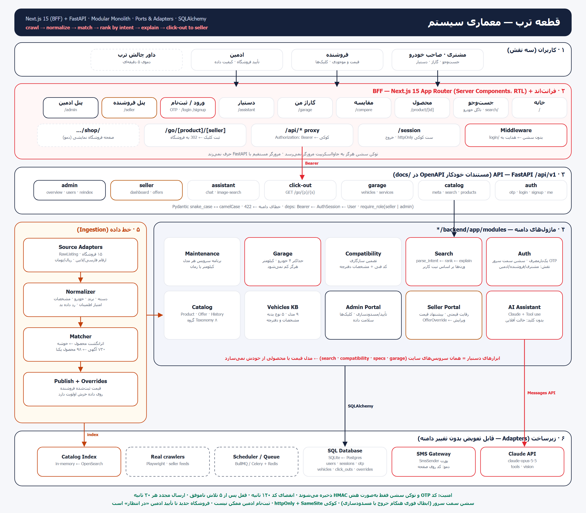

# قطعه ترب — همه‌چیز برای ماشینت، یک‌جا

Submission for Torob's «ترب ... رو بساز» challenge: a Torob for car parts. It compares prices across shops, checks that a part fits **your** car, reminds you when each service is due, and lets you ask an AI assistant. A Torob-style click-out sends the buyer to the shop that sells the part.



## Run

```bash
# backend (FastAPI) — http://localhost:8000/docs
cd backend
python -m venv .venv && .venv/Scripts/pip install -r requirements.txt   # macOS/Linux: .venv/bin/pip
.venv/Scripts/python -m uvicorn app.main:app --reload --port 8000

# frontend (Next.js) — http://localhost:3000
cd frontend
npm install && npm run dev
```

Optional: put `ANTHROPIC_API_KEY=…` in `backend/.env` to use Claude for the assistant and photo search. Without a key the assistant answers in offline mode.

## Demo accounts

Log in with the phone number. The one-time code appears on screen as a simulated SMS (`OTP_DEV_MODE=true`).

| Role | Phone | Notes |
|---|---|---|
| Regular user | `09120000003` | Garage with 4 cars: hatchback, sedan, pickup, sport |
| Seller | `09120000002` | «یدک‌پارت» shop: 35 products, edit prices and stock |
| Admin | `09120000001` | Approve or block shops, clicks, data quality, re-crawl |

New users can sign up at `/signup`. A shop that signs up stays «در انتظار تأیید» (pending) until an admin approves it.

## Structure

```
backend/                     FastAPI · SQLAlchemy · pytest (34 tests)
  app/main.py                app, lifespan: crawl → seed users → apply seller overrides
  app/api/deps.py            Bearer → session → user, require_role(...)
  app/api/routes/            auth · catalog · garage · commerce(click-out, assistant) · seller · admin
  app/modules/
    ingestion/               sources (shop adapters) → normalize → pipeline (match)
    catalog/                 taxonomy, models, repository (in-memory index)
    search/                  intent parser + ranker with explanations
    compatibility.py         fitment guarantee
    vehicles.py              vehicle KB + per-model service manual
    garage.py, maintenance.py
    auth.py                  OTP (HMAC-hashed, TTL, lockout), server-side sessions, SmsSender port
    seller_portal.py         competition view, price edits (OfferOverride), clicks
    admin_portal.py          users, shops, click-outs, data quality
    assistant/               Claude tool-use agent + offline fallback
frontend/                Next.js 15 frontend + BFF
  src/middleware.ts          auth guard → /login
  src/app/session/           sets / clears the httpOnly session cookie
  src/app/api/[...path]/     proxy → FastAPI with Bearer token
  src/app/go/…               click-out: log + redirect to the seller
  src/app/{login,signup,seller,admin,garage,search,product,compare,assistant}
docs/                        architecture + how-it-works diagrams
```

Tests: `cd backend && .venv/Scripts/python -m pytest -q`
